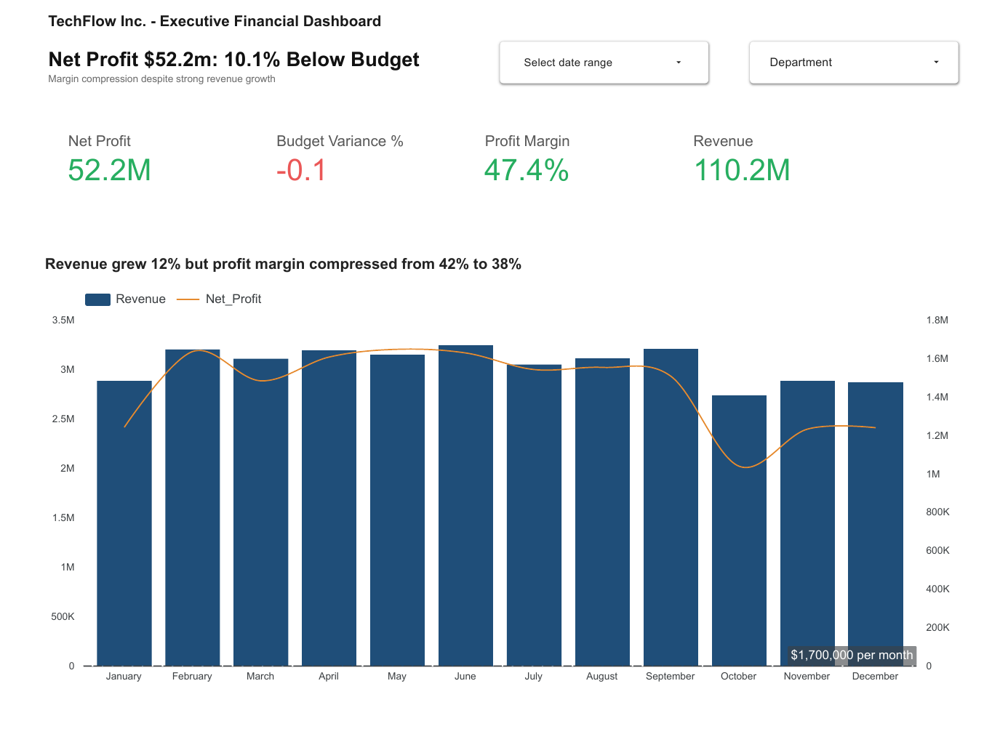
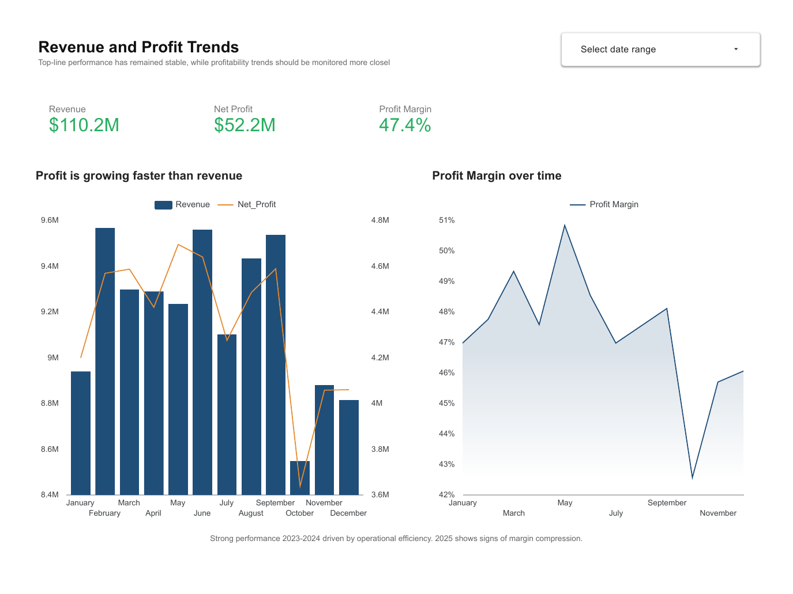
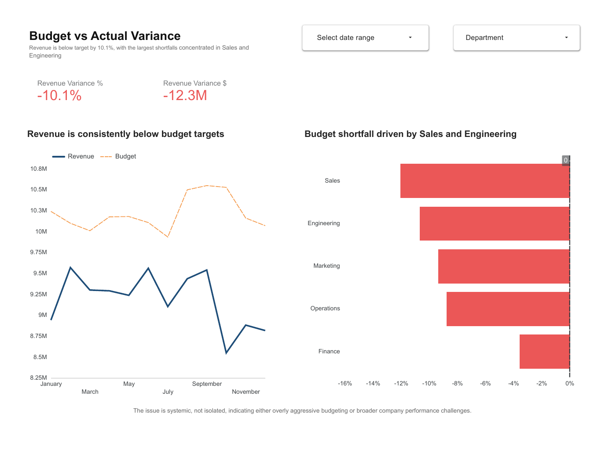
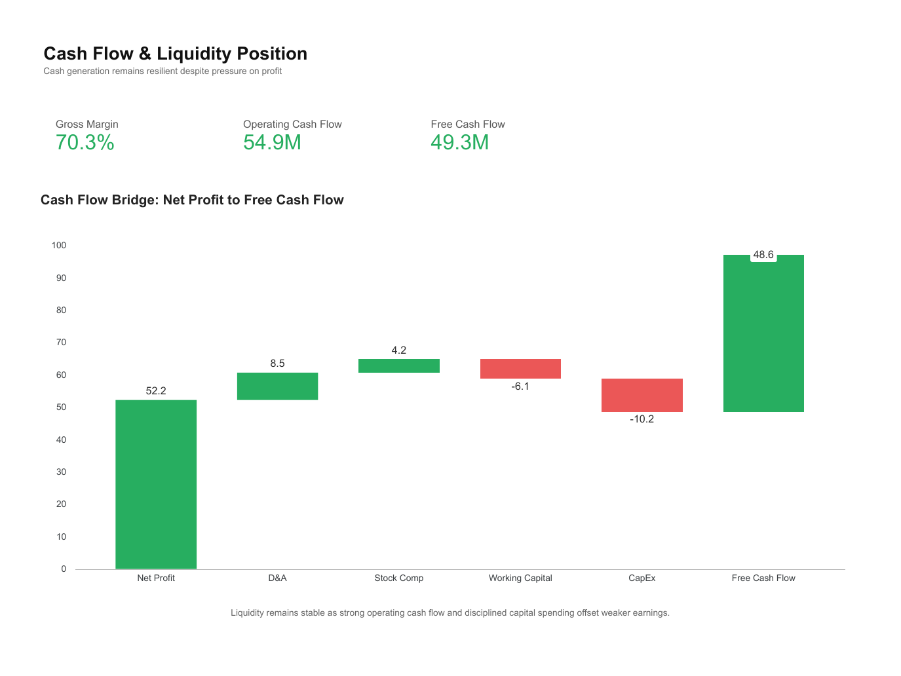

# CFO Executive Dashboard: TechFlow Inc.

**Revenue reached $110.2M, but results finished 10.1% below budget as costs grew faster than sales. This dashboard shows the CFO where margin is leaking and what to fix first.**

   

**[View the live dashboard](https://lookerstudio.google.com/reporting/7edc9bf7-a093-4a6d-af91-8fd97fbd6e49)** · **[Download the executive report (PDF)](reports/techflow-inc-dashboard.pdf)**

---

## Business problem

TechFlow Inc. is growing revenue, yet profitability is slipping. The CFO and leadership team need one view that answers four questions:

1. How is overall revenue performing?
2. Are profits keeping pace with growth?
3. Where are we underperforming against budget?
4. What is happening across departments and operations?

**North star metric:** Profit Margin % vs Budget, reviewed weekly, because it shows whether growth turns into budget-aligned profit.

## Approach

1. **Generate the dataset** in Python (`scripts/generate_financial-data.ipynb`): synthetic monthly financials by department and region, with budget and prior-year figures.
2. **Prepare summaries** in pandas: monthly, department, region and budget-variance tables (`data/`).
3. **Define KPIs** as calculated fields in Looker Studio (see table below).
4. **Build four executive pages**, each titled with its conclusion rather than a topic:
   - Executive Financial Performance Overview
   - Profitability Under Pressure Despite Revenue Growth
   - Systemic Underperformance Against Budget
   - Cash Flow Remains Resilient Despite Earnings Pressure
5. **Validate** that totals match across every visual.

## Key findings

| Finding | Number | What it means |
|---|---:|---|
| Revenue | $110.2M | Growth is strong |
| Net profit | $52.2M | Profitable, but under pressure |
| Performance vs budget | −10.1% | A real gap between growth and efficiency |
| Revenue gap vs budget | $12.3M | Budget assumptions were too optimistic |
| Underperforming departments | Sales, Engineering | A structural issue, not one-off variance |
| Free cash flow | ~$49.3M | Liquidity is healthy despite earnings pressure |

### Recommendations

| Priority | Action |
|---|---|
| High | Reduce cost inefficiencies in Sales and Engineering |
| High | Shift the focus from revenue growth to margin protection |
| Medium | Recalibrate budget assumptions |
| Medium | Review profitability metrics weekly instead of monthly |

### KPI definitions

| KPI | Formula |
|---|---|
| Net Profit | Revenue − Costs |
| Profit Margin % | Net Profit ÷ Revenue |
| Budget Variance % | (Actual − Budget) ÷ Budget |
| Revenue Variance $ | Actual − Budget |
| Free Cash Flow | Operating Cash Flow − CapEx |

## Visuals

**Executive overview**


**Profitability under pressure**


<details>
<summary>Budget performance and cash flow pages</summary>




</details>

## How to run

1. Open `scripts/generate_financial-data.ipynb` in Jupyter or Google Colab and run it to regenerate the data:
   ```bash
   pip install -r requirements.txt
   jupyter notebook scripts/
   ```
2. In Looker Studio, connect the CSVs in `data/` as data sources.
3. Add the calculated fields from the KPI table, then build scorecards, time series and department/region breakdowns with date and department filters.

## Folder structure

```text
cfo-executive-dashboard-techflow/
├── data/          # financial data + monthly, department, region and budget summaries
├── scripts/       # data generation notebook
├── reports/       # executive dashboard PDF
├── images/        # dashboard screenshots for this README
└── assets/        # banner
```

## Contact

**Julio Carneiro** · Data Analyst · Toronto, ON
[LinkedIn](https://www.linkedin.com/in/juliocezarcarneiro/) · [Portfolio](https://github.com/juliocezarcarneiro) · [Email](mailto:juliocezarcarneiro@outlook.com)
